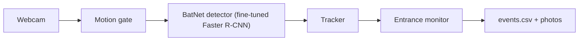

# Smart Bat Box

> **Built at MHacks 2026.** My part was the machine learning: I fine-tuned
> [BatNet](https://github.com/GabiK-bat/BatNet)'s Faster R-CNN bat detector in
> PyTorch on 10,000+ images, then trained a tiny FOMO model in Edge Impulse to run
> on an Arduino UNO Q. My teammates built the bat box, the temperature, humidity,
> light and sound sensors, and the live dashboard.

| Result (held-out photos) | Before | After |
| --- | --- | --- |
| Hand-labelled bats found | 3% (1 of 33) | 70% (23 of 33) |
| People correctly ignored | 49% (first fine-tune) | 96% (of 398) |
| Non-bat photos called a bat | 42% (first fine-tune) | 13% (of 1,136) |
| Speed | ~2 frames/s on CPU | 25 ms/frame (RTX 4070), ~10 ms/frame on the UNO Q (FOMO) |

A hackathon prototype that watches a bat box entrance with a webcam. The live
view says **BAT DETECTED** or **NOT A BAT**. Behind the scenes, it follows each
bat, decides whether its completed path means **IN** or **OUT**, and saves a
snapshot and a CSV event record.

Bats are declining and face threats including habitat loss and white-nose
syndrome. See [Bat Conservation International, State of the Bats 2023
report](https://digital.batcon.org/state-of-the-bats-report/2023-report/).
Our aim is to make bat box activity easier to observe and review through photos
and a record of arrivals and departures.

## How it works



1. OpenCV background subtraction checks for motion. BatNet runs while something
   moves or a bat is already being tracked.
2. The detector finds bat boxes. The tracker matches nearby box centres across
   frames, giving each bat a track ID and remembering its path.
3. When a track expires after missed detections, the entrance monitor judges its
   first and last positions. It keeps the frame with the highest detection
   confidence for the snapshot and runs the species classifier once per event.

Place the camera **outside the box, looking at the entrance slot**, with the slot
away from the frame edges. Direction is inferred automatically:

| Completed path | Decision |
| --- | --- |
| Starts at a frame edge, disappears in the middle | IN |
| Appears in the middle, ends at a frame edge | OUT |
| Edge to edge, or middle to middle | Ignore |

Short tracks are ignored. Each accepted event contributes the middle appearance
or disappearance point to the learned entrance. After five events by default,
the monitor uses the median location and a radius to reject points far from it.
Learning is saved in `data/entrance_points.json` between runs. If the camera moves,
the entrance needs to be learned again. Quitting discards unfinished tracks.

These are path-based estimates: occlusion or a missed detection can look like a
bat entering, especially before the entrance has been learned.

## Windows setup

Use PowerShell in the project folder. The team's existing environment uses
Python 3.14 and an NVIDIA RTX 4070 Laptop GPU. Reuse `.venv` if it is already set up;
for a fresh environment:

```powershell
cd C:\Users\pyara\smart-bat-box
$env:PYTHONWARNINGS = "ignore"
python -m venv .venv
.\.venv\Scripts\Activate.ps1
python -m pip install torch torchvision --index-url https://download.pytorch.org/whl/cu130
python -m pip install -r requirements.txt
python -m pip install Pillow
python vision/download_model.py
```

Install the CUDA build before the requirements on a fresh environment. Pillow is
also used by the training and data tools. Check GPU access with:

```powershell
python -c "import torch; print(torch.cuda.is_available())"
```

The downloader places BatNet's base package at
`models/detection/basemodel.pt.zip` and skips downloading if it already exists.
Keep this package even when using fine-tuned weights: it provides the model code
and species classifier. The detector automatically loads
`models/detection/finetuned_detector.pth` when present; otherwise it uses the base
detector. The current fine-tuned model is v3, with backups named
`finetuned_detector_v1.pt`, `finetuned_detector_v2.pt`, and
`finetuned_detector_v3.pt` in the same folder.

## Run the camera

With the environment active, run from the project root:

```powershell
$env:PYTHONWARNINGS = "ignore"
python vision/entrance_tracker.py
```

The live runner uses **`CAMERA_INDEX = 1` in
`vision/entrance_tracker.py`**. Choose the index matching your camera there
(`0` is commonly the built-in webcam). This runner uses its own setting;
`SBB_CAMERA_INDEX` in `vision/config.py` does not select its camera.
Read `vision/config.py` for paths and detector, tracking, and entrance defaults.
Its environment overrides, such as `SBB_DETECTION_CONFIDENCE` and `SBB_FORCE_CPU`,
let you adjust those settings without changing the file.

The **Entrance Tracker** window shows the camera feed with green **BAT DETECTED**
or red **NOT A BAT** text. Track IDs, species, and IN/OUT counts are not drawn on
the live view. Completed events appear in the terminal. Press **q** in the video
window to quit; the terminal then prints the session's IN and OUT totals.

| Output | Location |
| --- | --- |
| Snapshot with bat box, direction, ID, and time | `data/events/*.jpg` |
| Same frame without drawings, for future training | `data/events/raw/*.jpg` |
| Event log | `data/events/events.csv` |
| Learned entrance points | `data/entrance_points.json` |

The CSV columns are `time`, `direction`, `bat_id`, `detection_confidence`,
`species`, `species_confidence`, and `photo`. Track IDs are local to a run;
species can be `unknown`. IN minus OUT measures the change during a session,
not the box's total population.

## Training pipeline

These are teammate commands for preparing data and training; running the camera
does not require rerunning them. Use the active environment and project root.
The Open Images steps expect the existing `data/openimages/annotations.csv`.
Example order:

| Step / script | Purpose | Command |
| --- | --- | --- |
| 1. `download_data.py` — negatives | Add Open Images examples of things mistaken for bats. | `python training/download_data.py negatives Person "Human face" Lamp --per-class 100` |
| 1. `download_data.py` — inaturalist | Download openly licensed North American bat photos, including Michigan observations, with credits. | `python training/download_data.py inaturalist --per-species 100` |
| 2. `capture_room_negatives.py` | Save local webcam examples with no bats or bat pictures in view; press q to stop. | `python training/capture_room_negatives.py` |
| 3. `auto_label.py` | Accept confident automatic bat boxes, reserve iNaturalist check photos, and make audit sheets. | `python training/auto_label.py --sheets 4 --no-refine` |
| 4. `refine_labels.py` | Use BatNet segmentation to reject questionable boxes and refine accepted ones. | `python training/refine_labels.py --sheets` |
| 5. `synthesize_data.py` | Paste training bat crops onto non-bat backgrounds and save boxes and a preview. | `python training/synthesize_data.py --count 2000` |
| 6. `quality_check.py` | Check images, boxes, duplicates, and split leakage; write training exclusions. | `python training/quality_check.py --write-exclude` |
| 7. `finetune_detector.py` | Train the detector using Open Images, automatic labels, synthetic images, and room negatives. | `python training/finetune_detector.py` |
| 8. `evaluate.py` | Compare saved detectors on check photos, false alarms, and inference speed. | `python training/evaluate.py models/detection/finetuned_detector_v2.pt models/detection/finetuned_detector.pth` |
| 9. `find_hard_negatives.py` | Rank non-bat photos and Open Images classes that fool the detector; use them in the next data round. | `python training/find_hard_negatives.py` |

Inspect the audit sheets in `data/audit/` and the synthetic preview at
`data/synthetic/preview.jpg` before training. Auto-labelling writes
`data/auto_labels_raw.csv`, and refinement writes `data/auto_labels.csv`.
Auto-labelling normally runs refinement too; the commands above use `--no-refine`
to show the two steps separately. Synthetic outputs are
`data/synthetic/images/` and `data/synthetic/labels.csv`.

Fine-tuning continues from the current detector by default; `--from-scratch`
starts from BatNet's original detector. It changes the detector, leaving the
species classifier unchanged. iNaturalist check photos are listed in
`data/inaturalist/test_images.txt`; keep held-back photos out of training.

For options or unclear defaults, **see the script's `--help`**, for example
`python training/finetune_detector.py --help`. The webcam capture script uses
constants rather than command-line options; read its opening instructions.

## Testing

Use unittest; pytest is not required. From the project root:

```powershell
$env:PYTHONWARNINGS = "ignore"
$env:PYTHONDONTWRITEBYTECODE = "1"
.venv\Scripts\python.exe -m unittest discover -s tests -t .
```

The tests use fake detections and temporary files without a webcam or model
weights. Two expected failures in `tests/test_entrance_monitor.py` cover photo
and CSV write failures. They are known limitations; a successful run reports
`OK (expected failures=2)`.

To rehearse the live pipeline without a webcam, use the real CUDA detector on
synthetic clips made from validation photos:

```powershell
python tools/replay_demo.py --clips 5 --seed 42
```

This covers IN, OUT, flypast, camera movement, and a person. It requires the base
package, fine-tuned weights, and a CUDA GPU. Reports, a contact sheet, per-frame
results, and event snapshots go under `data/rehearsal/`, with individual runs in
separate folders. See `python tools/replay_demo.py --help` for options.
Synthetic rehearsal does not establish accuracy on real entrance videos.

## Results (to be filled in after final training)

Pending final evaluation. Record the final model version, data split, detection
threshold, and hardware alongside:

- Bat detections on hand-labelled and held-back photos: **TBD**.
- False alarms on non-bat, people, and local room images: **TBD**.
- Inference speed: **TBD**.
- IN/OUT accuracy on labelled entrance videos: **TBD**.

## Limitations and next steps

- Our detector fine-tuning uses mostly colour photos. A real night deployment
  needs an infrared camera, such as a Raspberry Pi NoIR camera with an 850 nm IR
  light, and validation on footage from that setup.
- The species classifier is BatNet's original European model. Its species
  guesses are not validated for Michigan bats; Michigan-species classifier
  fine-tuning is a next step. See the [BatNet model description](https://github.com/GabiK-bat/BatNet).
- Test complete entrance videos, including blur, occlusion, and multiple bats.
  Split videos by recording; passing unit tests and photo checks does not
  establish real-world counting accuracy.
- Photo and CSV write failures can leave counts and entrance learning out of
  sync with saved records; the two expected failures track this remaining work.
- This project is **non-commercial**: [BatNet](https://github.com/GabiK-bat/BatNet)
  is CC BY-NC-SA 4.0, and most downloaded iNaturalist photos are CC BY-NC.
  See [CREDITS.md](CREDITS.md) for sources, license counts, and every photo credit.
